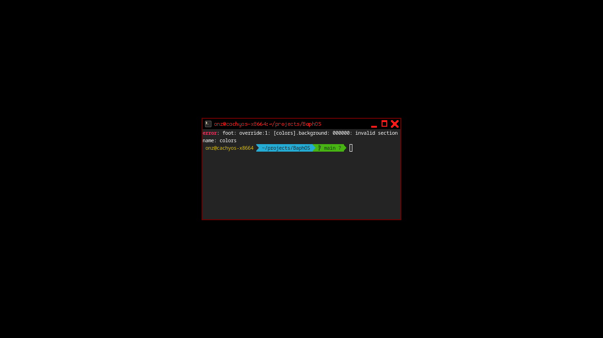

# BaphOS

Пиксельный райс для слабого железа: **labwc** (окна как в Windows) + оболочка на **Quickshell**.
Палитра — чёрный, алый, тёмно-красный. Вся графика рисуется кодом (`art/*.py`, Pillow, nearest-neighbor).



## Установка

```sh
git clone https://github.com/oniczzz/BaphOS.git ~/projects/BaphOS
cd ~/projects/BaphOS
./install.sh --system     # без --system — только пользовательская часть, без сессии в SDDM
```

Нужны пакеты: `labwc swaybg foot grim slurp wdisplays xorg-xcursorgen python-pillow quickshell`,
шрифт `cozette-otb` (AUR). Потом в SDDM выбрать сессию **BaphOS**.

`install.sh` ставит симлинки на папки репозитория; чужой файл на их месте переименовывается в
`<имя>.bak.<дата>`. `./uninstall.sh [--system]` убирает только свои симлинки.

## Клавиши (labwc)

| Клавиши | Действие |
|---|---|
| Alt+Tab / Alt+Shift+Tab | переключение окон |
| Super+←/→/↑/↓ | окно к краю / развернуть |
| Super+A | развернуть / восстановить |
| Alt+F4 | закрыть окно |
| Super+Enter | терминал (foot) |
| Super+E | файлы |
| Super+B | браузер |
| Super+Space | запуск программ |
| Super+P | мониторы (wdisplays) |
| Print / Shift+Print | скриншот экрана / области → ~/Pictures/Screenshots |
| Правый клик по столу | меню |

## Состав

```
art/        генераторы графики: pixel.py (палитра), buttons.py, cursor.py
labwc/      rc.xml, menu.xml, autostart, environment
themes/     тема окон labwc (themerc + кнопки)
assets/     курсор BaphOS (16 px), превью
session/    сессия BaphOS для SDDM
```

## Лицензия

MIT. Шрифт Cozette — отдельный пакет (MIT), в репозиторий не входит.
