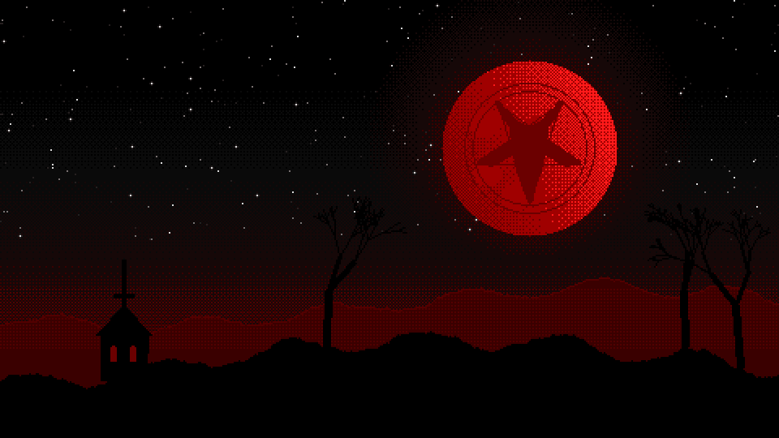
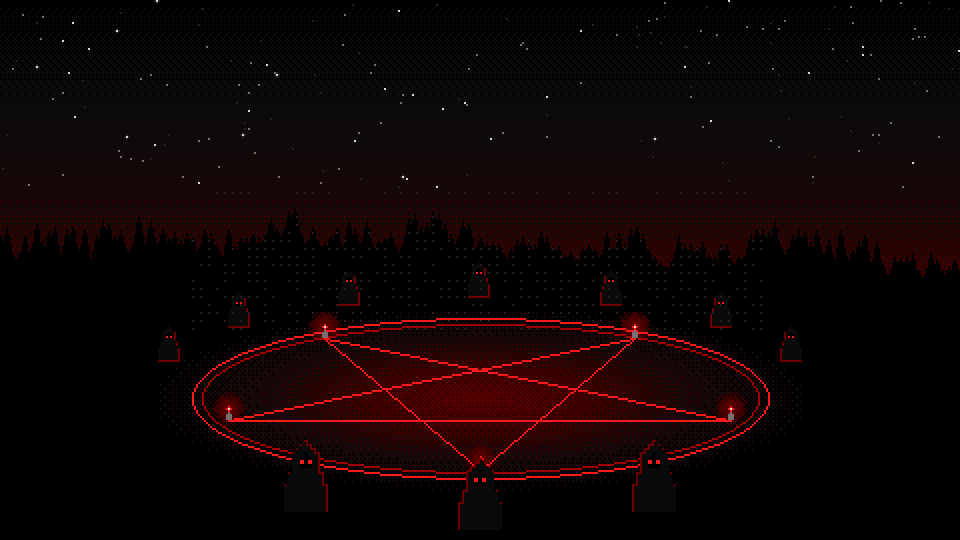
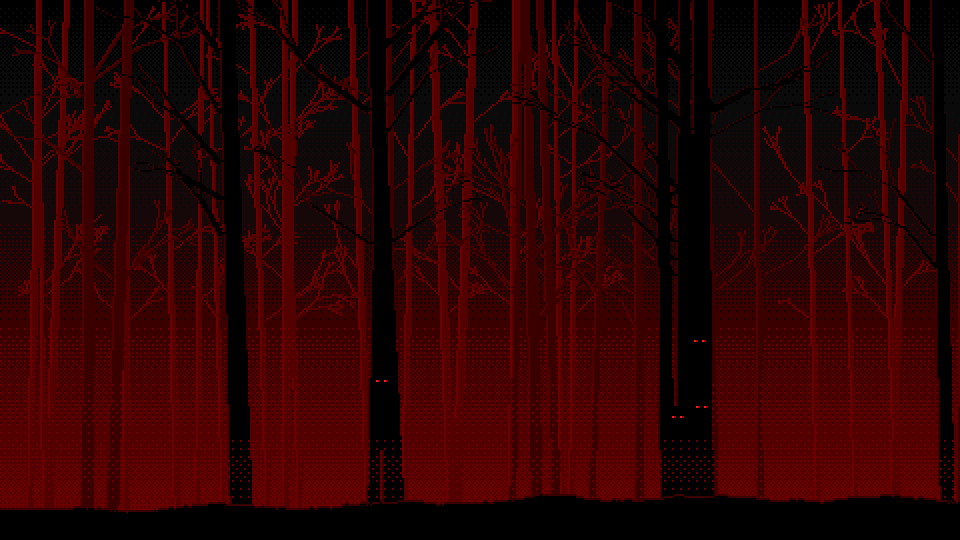
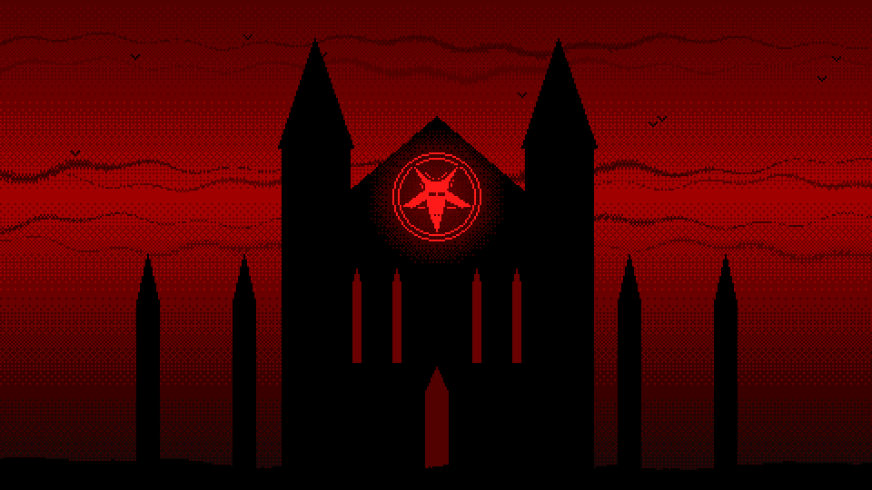
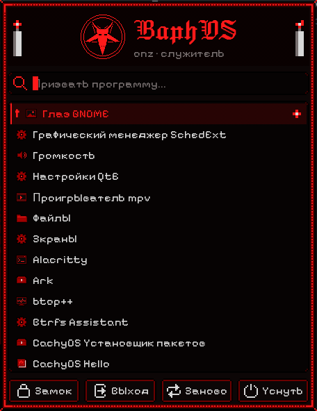

# BaphOS

Пиксельный сатанинский райс для **niri** с оболочкой на **Quickshell**, для слабого железа
(без blur и шейдеров). Палитра — чёрный, алый, тёмно-красный. Вся графика рисуется кодом
(`art/*.py`, Pillow, nearest-neighbor).

> В разработке: этапы — база niri → панель задач и Пуск → обои и сигил → темы → сюжет.



| | |
|---|---|
|  |  |
|  |  |




## Графика

Всё рисуется кодом в `art/`: палитра из 11 цветов, переходы — упорядоченный дизеринг (Байер 4x4),
сцены в разрешении экрана / 4 и увеличение x4 без сглаживания — под каждый размер экрана своя картинка.

- **Обои** (`art/wallpapers.py`): Багровая луна, Ритуал, Лес, Собор, Сигил. Сменить — `Mod+Shift+W`
  (переход — пиксельная мозаика). Обои **живые**: звёзды мерцают, пламя свечей дрожит, культисты моргают,
  глаза в лесу появляются и пропадают, розетка собора пульсирует, пролетают мыши и вороны, «Сигил» глитчит.
  Картинка статична — оживают только мелкие спрайты, 8 тиков в секунду, без шейдеров.
- **Сигил** (`art/sigil.py`): двойной круг, перевёрнутая пентаграмма, козлиная голова.
- **Значки** (`art/icons.py`): тема BaphOS, 16 px (+32/48/64), программы и папки; остальное — из Adwaita.
- **Курсор** (`art/cursor.py`): 16 px.

## Панель задач и Пуск

- **Пуск** (кнопка с сигилом или `Mod+D`): поиск по приложениям, стрелки + Enter, Esc — закрыть;
  выход / перезагрузка / выключение — по второму клику («Точно?»).
- **Окна**: клик — перейти к окну, средний клик — закрыть. Свернуть окно в niri нельзя — такой функции у него нет.
- **Справа**: трей, раскладка (клик — переключить), звук (колесо — громкость, клик — выкл), заряд батареи, часы.

## Установка

```sh
git clone https://github.com/oniczzz/BaphOS.git ~/projects/BaphOS
cd ~/projects/BaphOS
./install.sh
```

Пакеты: `niri quickshell python-pillow xorg-xcursorgen librsvg foot fastfetch adw-gtk-theme qt6ct`, шрифт `cozette-otb` (AUR).

`install.sh` трогает только `~/.config` и `~/.local/share`:
- `~/.config/niri/config.kdl` становится коротким файлом: `include` BaphOS и `include "monitor.kdl"`.
  Свои настройки пиши в нём **ниже** — они перекроют BaphOS. Старый файл уходит в `config.kdl.bak.<дата>`.
- `~/.config/quickshell/baphos` и курсор `~/.local/share/icons/BaphOS` — симлинки на репозиторий.

`./uninstall.sh` убирает симлинки и возвращает прежний `config.kdl` из последнего бэкапа.

## Состав

```
art/          генераторы графики: pixel.py, cursor.py, sigil.py, wallpapers.py, icons.py
niri/         baphos.kdl — оформление, анимации, клавиши
quickshell/   оболочка BaphOS: shell.qml, Taskbar, StartMenu, Wallpaper, Theme, Store (настройки), Niri
assets/       icons/BaphOS (значки + курсор), wallpapers/, sigil/, превью
```

## Лицензия

Код и графика BaphOS — MIT. Чужое, с лицензиями рядом:

- шрифты в `fonts/` — SIL Open Font License 1.1: [Pixelify Sans](https://github.com/eifetx/Pixelify-Sans),
  [Jacquard 24](https://github.com/scfried/soft-type-jacquard), [Press Start 2P](https://fonts.google.com/specimen/Press+Start+2P)
  (взяты из [google/fonts](https://github.com/google/fonts));
- иконки интерфейса `assets/ui/pixelarticons` — [Pixelarticons](https://github.com/halfmage/pixelarticons), MIT, перекрашены в палитру;
- терминальный шрифт Cozette — пакет `cozette-otb` (MIT), в репозиторий не входит.
