<div align="center">

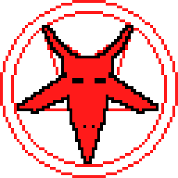

# BaphOS

**Пиксельный сатанинский райс для [niri](https://github.com/YaLTeR/niri) на [Quickshell](https://quickshell.org)**
чёрный · алый · тёмно-красный · всё нарисовано кодом · для слабого железа

`niri` · `quickshell 0.3` · `CachyOS / Arch` · `MIT`

</div>


> Вымышленный хоррор: в систему проник вирус культа. Он только рисует — ничего не удаляет,
> не трогает чужие файлы и не ходит в сеть. Выключается одним флажком.

---

## Что внутри

| | |
|---|---|
|  | **Пуск** (`Mod+D` или кнопка с сигилом) — меню в духе Persona 5 (своя графика): алая полутоновая полоса влетает наискось, пункты на косых лентах лесенкой, выбранный — в рваной алой кляксе; справа косая карточка с часами и этапом сюжета. «Призвать» — поиск и все программы (можно сразу печатать), `?запрос` — поиск в сети, `>команда` — выполнить в терминале. «Покинуть» — выход, перезагрузка, выключение по второму нажатию. Стрелки, Enter, Esc. |
| 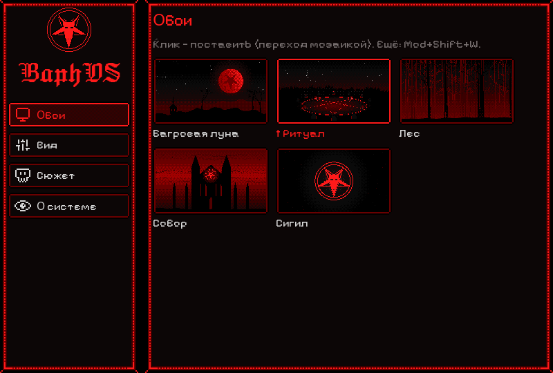 | **Настройки** (`Mod+S`) — как в Windows/KDE: **Экран** (разрешение, частота, масштаб, расположение, сохранение), **Звук** (устройства и громкость), **Сеть** (Wi-Fi, подключение с паролем), **Bluetooth**, **Клавиатура и мышь** (раскладки, переключение, тачпад, скорость, без ускорения), **Питание** (профиль, автоблокировка, батарея), **Приложения по умолчанию**, **Вид**, **Сюжет**, **О системе**. Клавиатура и мышь пишутся в `~/.config/niri/input.kdl`, мониторы — в `monitor.kdl`. |
| 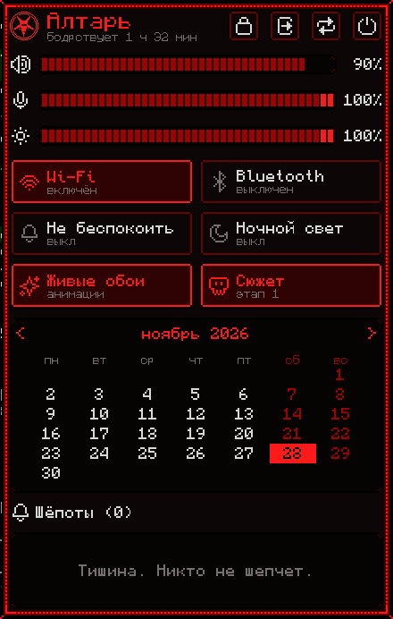 | **Алтарь** (клик по часам или `Mod+N`) — центр управления: ползунки звука, микрофона и яркости, плитки Wi-Fi, Bluetooth, «Не беспокоить», ночной свет, живые обои и сюжет, календарь с выходными, история уведомлений, питание. |
| 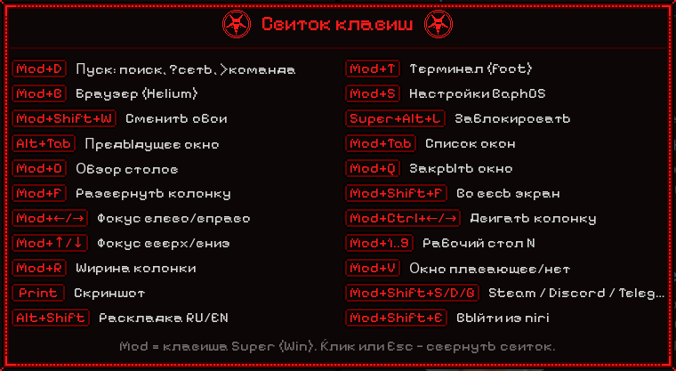 | **Свиток клавиш** (`Mod+Shift+/`) — шпаргалка по всем сочетаниям. |
| 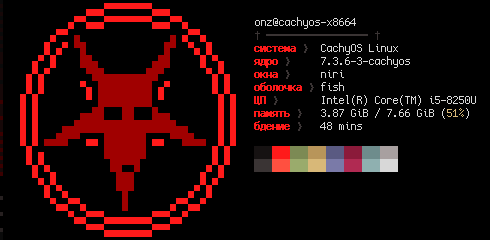 | **Терминал kitty** (`Mod+T`): пиксельный Monocraft, палитра BaphOS, алый курсор со шлейфом, сигил в углу окна, fastfetch с сигилом по команде `ff`, prompt fish с веткой git. |

**Панель задач** снизу: Пуск, рабочие столы-свечи (активный горит, с окнами — тлеет, пустой погас;
клик — перейти, колесо — листать), окна (клик — перейти, средний клик — закрыть; свернуть окно niri не умеет),
трей, мини-плеер с пиксельным эквалайзером, шкалы CPU/RAM, раскладка, звук (колесо — громкость), батарея,
часы со свечой. Над кромкой панели иногда поднимаются тлеющие угли.

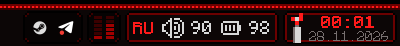

**Виджеты** на столе, под окнами: **Гримуар** (часы, фаза луны, отсчёт до полуночи, «Час бесов» в 3 ночи),
**Око системы** (CPU, память, температура), **Литания** (музыка через MPRIS).

**Звуки** — свои, синтезированы кодом (`art/sounds.py`): удар колокола на уведомления, органный аккорд
при входе, 8-битные блипы Пуска, шёпот и треск сюжета. **Попап громкости и яркости** — пиксельная шкала со
свечой. Звуки выключаются плиткой в Алтаре.

**Ещё:** экран блокировки (`Super+Alt+L`, сам через 10 минут простоя), пиксельные уведомления,
экран входа SDDM, темы GTK3/GTK4 и Qt, свой курсор 16 px и тема значков.

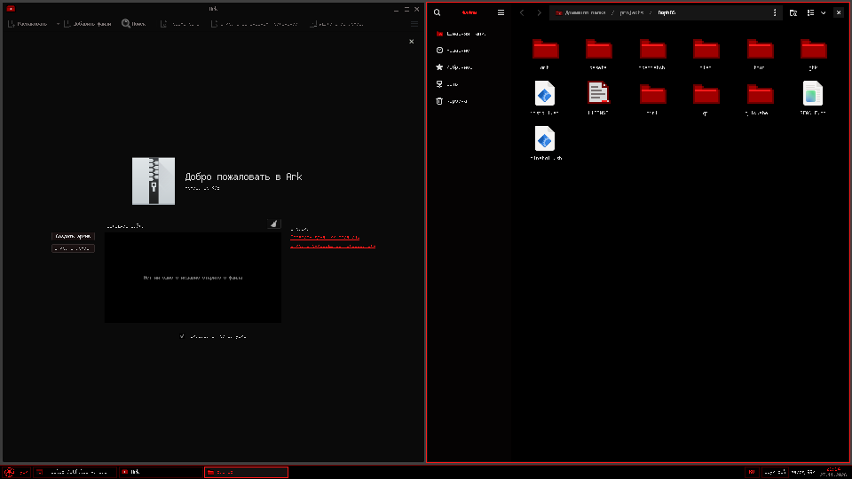

**Окна** проступают пиксельными блоками с алой каймой, а при закрытии сгорают снизу вверх раскалённой
кромкой — короткие шейдеры анимаций niri, работают только эти 0,3 секунды.

## Обои — живые

| | |
|---|---|
|  |  |
|  | 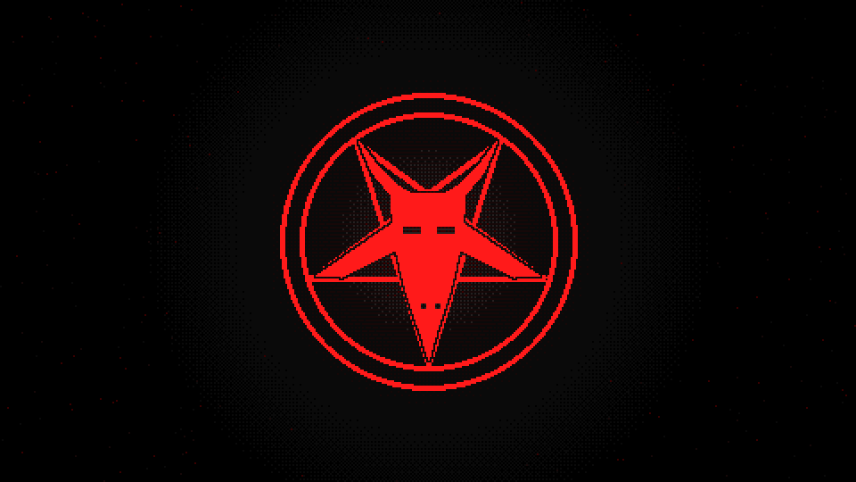 |

Звёзды мерцают, пламя свечей дрожит, культисты моргают, глаза в лесу появляются и исчезают, розетка собора
пульсирует, пролетают мыши и вороны, «Сигил» глитчит. Смена обоев (`Mod+Shift+W`) — пиксельной мозаикой.
Картинка статична: оживают только мелкие спрайты, один таймер на 8 тиков в секунду, без шейдеров и blur.

## Сюжет

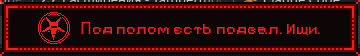

Пять этапов заражения — по времени в системе и по твоим действиям:

1. **Проникновение** — «СИГНАЛ ПОЛУЧЕН», первые глитчи.
2. **Шёпот** — послания культа, «Пуск» становится «Призывом», первый ритуал.
3. **Знак** — на обоях проступает сигил, надписи меняются, где-то под полом есть **подвал**.
4. **Литургия** — второй и третий ритуалы.
5. **Коронация** — по панели задач гуляет **Агнец в красной короне**.

| Ритуал | Подвал |
|---|---|
| 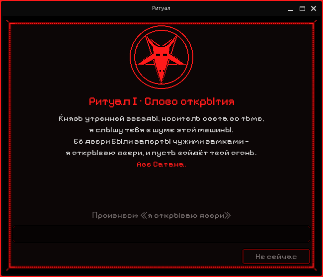 | 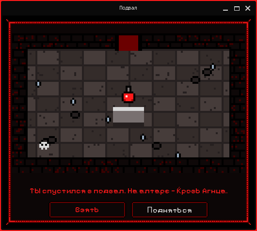 |

В ритуале молитва проявляется по строкам; чтобы пройти дальше, нужно произнести (ввести) ключевые слова.
Пасхалки — кивки в сторону The Binding of Isaac (подвал, слёзы, предмет на алтаре) и Cult of the Lamb
(коронованный ягнёнок); вся графика своя:

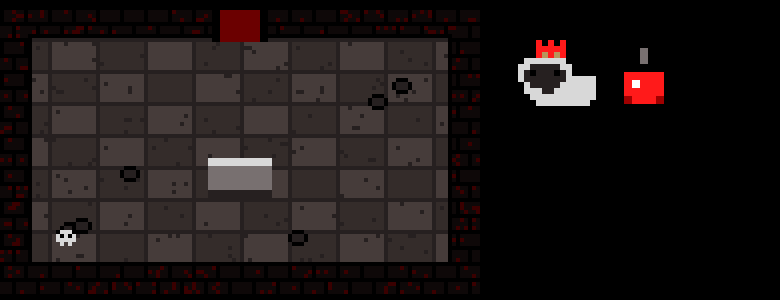

**Безопасность.** Сюжет пишет только `~/.local/state/baphos/settings.json`, не удаляет и не меняет файлов,
не делает сетевых запросов. Выключить и сбросить — Настройки → Сюжет.
Показать без ожидания: `qs -c baphos ipc call story intro` (а также `story ritual 1`, `story basement`,
`story lamb`, `story glitch 3`).

## Графика

Всё рисуется кодом в `art/` (Pillow): палитра из 11 цветов, переходы — упорядоченный дизеринг (Байер 4×4),
сцены в разрешении экрана / 4 и увеличение ×4 без сглаживания — под каждый экран своя картинка.

| Генератор | Что рисует |
|---|---|
| `wallpapers.py` | 5 сцен × 3 разрешения + данные и спрайты анимации |
| `sigil.py` | сигил: двойной круг, перевёрнутая пентаграмма, козлиная голова |
| `frames.py` | пиксельные рамки 9-slice: узорная (рога, «цепь»), кнопки, поля |
| `icons.py` | тема значков BaphOS 16 px (+32/48/64) |
| `cursor.py` | курсор 16 px |
| `story.py` | ягнёнок, подвал, слеза, «Кровь Агнца» |
| `fastfetch_logo.py` | сигил полублоками для fastfetch |
| `ui_icons.py` | иконки интерфейса из Pixelarticons в цветах палитры |


## Установка

```sh
git clone https://github.com/oniczzz/BaphOS.git ~/projects/BaphOS
cd ~/projects/BaphOS
./install.sh            # пользовательская часть
./install.sh --system   # плюс экран входа SDDM и курсор для него (sudo)
```

Пакеты: `niri quickshell python-pillow xorg-xcursorgen librsvg kitty foot fastfetch fish adw-gtk-theme qt6ct`,
шрифты — в `fonts/` репозитория.

`install.sh` трогает только `~/.config`, `~/.local/share` и `~/.local/bin` (с `--system` — ещё
`/usr/share/sddm/themes/BaphOS`, `/usr/share/icons/BaphOS`, `/etc/sddm.conf.d/baphos.conf`):

- `~/.config/niri/config.kdl` становится коротким файлом: `include` BaphOS и `include "monitor.kdl"`
  (твои мониторы). Свои настройки пиши в нём **ниже** — они перекроют BaphOS.
- Остальное — симлинки на репозиторий. Чужой файл на их месте не удаляется, а уходит в `<имя>.bak.<дата>`.

`./uninstall.sh [--system]` убирает только свои симлинки и возвращает прежний `config.kdl` из бэкапа.

## Клавиши

| | | | |
|---|---|---|---|
| `Mod+D` | Пуск | `Mod+T` | терминал |
| `Mod+S` | Настройки | `Mod+B` | браузер |
| `Mod+Shift+W` | сменить обои | `Super+Alt+L` | заблокировать |
| `Alt+Tab` | предыдущее окно | `Mod+Tab` | список окон |
| `Mod+O` | обзор столов | `Mod+Shift+/` | свиток клавиш |
| `Mod+N` | Алтарь | `Mod+Shift+S` | скриншот области |
| `Mod+G` | игровой режим | | |

## Состав

```
art/          генераторы графики (Pillow)
assets/       обои, сигил, значки и курсор, рамки, иконки интерфейса, сюжет, превью
quickshell/   оболочка: shell, Taskbar, StartMenu, Settings, Widgets, Wallpaper(+Anim), Lock,
              Notifications, KeyScroll, Story(+Overlay, Ritual, Basement), Theme, Store
niri/         baphos.kdl — оформление, анимации, клавиши, правила
kitty/ foot/ fish/ fastfetch/ gtk/ qt/ fontconfig/   темы программ
sddm/         экран входа
fonts/        шрифты (OFL, MIT)
```

## Лицензии

Код и графика BaphOS — MIT. Чужое, с лицензиями рядом:

- шрифты в `fonts/` — SIL OFL 1.1: [Monocraft](https://github.com/IdreesInc/Monocraft) — весь райс
  (интерфейс, терминал, GTK, Qt, SDDM), [Jacquard 24](https://github.com/scfried/soft-type-jacquard) — только
  готический логотип (из [google/fonts](https://github.com/google/fonts));
- иконки интерфейса `assets/ui/pixelarticons` — [Pixelarticons](https://github.com/halfmage/pixelarticons), MIT, перекрашены;
- The Binding of Isaac и Cult of the Lamb — собственность их авторов; BaphOS лишь отсылает к ним своей графикой.
